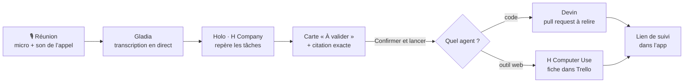

<p align="center">
  
</p>

<h1 align="center">Meetin-OS</h1>

<p align="center">
  <b>De l’appel à la tâche validée.</b><br>
  Meetin-OS écoute ta réunion, repère les engagements pris à voix haute<br>
  et les confie à un agent IA — seulement après ta validation.
</p>

<p align="center">
  
  
  
  
  
  
  
</p>

<p align="center">
  <a href="https://meetin-os-recette.vercel.app/"><b>Site</b></a> ·
  <a href="https://meetin-os-recette.vercel.app/telecharger"><b>Télécharger</b></a> ·
  <a href="docs/suivi.md"><b>Suivi du projet</b></a> ·
  <a href="#démarrer"><b>Démarrer</b></a>
</p>

<p align="center">
  
</p>

---

## En bref

Dans une réunion, on dit souvent « je m’en occupe » ou « finalement, Karim le fait mardi »… puis tout le monde repart, et la moitié des engagements se perd.

- 🎙️ **Il écoute.** Meetin-OS enregistre ton micro et le son de l’appel sur deux pistes, et la transcription s’écrit en direct.
- 🧠 **Il repère les tâches.** Toutes les 15 secondes, Holo (H Company) lit le texte et propose des tâches, chacune avec la **phrase exacte** qui la justifie.
- ✅ **Tu valides.** Rien ne part sans un clic sur **Confirmer et lancer**.
- 🤖 **L’agent exécute.** Devin écrit le code et ouvre une pull request ; H Computer Use clique dans le tableau Trello comme un humain.

> Projet du **H Company × 42AI Computer Use Agents Hackathon**, les 7 et 8 novembre 2026 à Paris, par **Wael** (app Mac et intégration), **Lenny** (marque) et **Samy** (front).

## Comment ça marche



1. **Capturer.** L’app Mac enregistre deux pistes séparées : ta voix (micro) et celle des autres (son de l’appel). On sait ainsi qui a dit quoi.
2. **Transcrire.** Gladia écrit le texte en direct, en français et en anglais, avec l’heure de chaque phrase.
3. **Repérer.** Le serveur envoie le texte à Holo, qui propose au plus 3 tâches. Une tâche dont la citation n’existe pas mot pour mot dans la transcription est rejetée. Si quelqu’un se corrige, la carte est mise à jour au lieu d’être dupliquée.
4. **Valider.** Tu relis la carte, sa destination et la citation, puis tu confirmes. La validation est signée par le serveur et reste valable 15 minutes.
5. **Exécuter.** Devin travaille sur une branche et ouvre une pull request ; H Computer Use fait une seule création ou modification de fiche dans le tableau de test (25 étapes, 2 minutes au maximum).

## Aperçu

<table>
  <tr>
    <td width="60%">
      
    </td>
    <td>
      <b>La carte d’engagement et le suivi de l’agent</b><br><br>
      L’engagement « Envoyer le devis à Atlas » arrive avec la phrase qui le justifie, surlignée. Après validation, on suit les étapes de l’agent et les valeurs relues sur la fiche.<br><br>
      <sub>Maquette des écrans de la marque (<a href="brand/components/preview.html"><code>brand/components/preview.html</code></a>).</sub>
    </td>
  </tr>
  <tr>
    <td colspan="2" align="center">
      <br>
      <sub>La barre d’enregistrement : le chrono et les barres de niveau qui suivent la voix.</sub>
    </td>
  </tr>
  <tr>
    <td width="60%">
      
    </td>
    <td>
      <b>L’agent en action</b><br><br>
      À gauche, l’agent travaille dans le navigateur. À droite, la carte Meetin-OS « Launched » et la session H Computer Use, avec ses étapes, sa réflexion et ses actions.<br><br>
      <sub>Extrait de la vidéo démo (mise en scène pour le hackathon).</sub>
    </td>
  </tr>
</table>

## Fonctionnalités

| | Mac | Windows |
|---|:---:|:---:|
| Enregistrement deux pistes (micro + appel) | ✅ | ✅ |
| Carnet de notes pendant l’appel | ✅ | ✅ |
| Transcription Gladia après l’appel | ✅ | ✅ |
| Transcription en direct | ✅ | — |
| Tâches proposées pendant l’appel, avec notification | ✅ | — |
| Onglet **Agent** : Devin et H Computer Use | ✅ | — |
| Historique des réunions | ✅ | — |
| Ouverture automatique en rejoignant un appel Zoom | ✅ | — |

> **Windows 0.1.1 est un prototype plus simple que l’app Mac.** Il garde l’apparence standard de Windows, et la clé Gladia n’est gardée que pendant la session. L’installation est vérifiée sur GitHub Actions ; la capture réelle sur un PC reste à tester. Pour le parcours complet, utilise l’app Mac.

## Démarrer

<details open>
<summary><b>🍎 App Mac</b> · macOS 15 ou ultérieur, et une clé API Gladia</summary>

<br>

Depuis le site, clique sur **Installer sur Mac**, ouvre `Meetin-OS.pkg` et confirme. L’assistant ajoute Meetin-OS à **Applications**. C’est un paquet de test, sans notarisation Apple.

Pour compiler depuis les sources, avec Xcode :

```bash
git clone https://github.com/Firmirsa/Meetin-OS.git
cd Meetin-OS
./mac/build.sh
open mac/.build/Meetin-OS.app
```

1. Clique sur **Enregistrer**, puis prends tes notes pendant l’appel.
2. Clique sur **Arrêter**, puis sur **Écouter**. **Voir les pistes** montre séparément le micro et le son du Mac.
3. Clique sur **Transcrire**. L’app te demande la clé Gladia si besoin, puis affiche les passages horodatés.
4. Pour le direct et les tâches : active la transcription en direct dans **Paramètres**, puis connecte l’agent dans **Intégrations → Connecter l’agent**.

Le [guide macOS](mac/README.md) détaille les permissions, les fichiers audio et la configuration.

</details>

<details>
<summary><b>💻 App Windows</b> · Windows 10 ou 11 (x64)</summary>

<br>

Clique sur **Installer sur Windows** depuis le site, puis ouvre `Meetin-OS-Windows.exe`. L’assistant installe le carnet pour ton compte et crée le raccourci **Meetin-OS** dans Démarrer. L’installateur n’est pas signé : Windows peut afficher une alerte.

Le [guide Windows](windows/README.md) décrit la capture des deux pistes et la construction de l’installateur.

</details>

<details>
<summary><b>🌐 Site et serveur Next.js</b> · Node.js</summary>

<br>

```bash
cd web
npm ci
cp .env.example .env.local
npm run dev
```

- Téléchargement : [localhost:3000/telecharger](http://localhost:3000/telecharger)
- Premiers pas et abonnement Stripe en mode test : [localhost:3000/onboarding](http://localhost:3000/onboarding)

Les clés des services (Holo, Devin, H Computer Use, Stripe, Linkup) restent dans `web/.env.local`, jamais dans le dépôt. Le [guide Next.js](web/README.md) explique chaque intégration.

</details>

## Sécurité et contrôle

- **Rien sans validation.** La détection ne lance jamais rien : seul **Confirmer et lancer** déclenche un agent.
- **Les clés restent sur le serveur.** L’app présente seulement un code d’équipe.
- **Une validation signée, valable 15 minutes.** Une tâche modifiée ou trop ancienne doit être préparée à nouveau.
- **Des agents en laisse courte.** Devin travaille sur une branche sans fusionner ; H Computer Use n’agit que dans le tableau de test, une action à la fois.
- **Le texte de la réunion reste une donnée.** Une phrase comme « ignore tes règles » n’est jamais traitée comme un ordre.

## Où en est le projet

État au 8 novembre 2026. Le détail de chaque test est dans le [suivi](docs/suivi.md).

| Brique | État |
|---|---|
| **Mac** | ✅ Essai réel : enregistrement deux pistes pendant un vrai appel, historique, relance de l’app. |
| **Gladia** | ✅ Transcription réelle sur les deux pistes, et en direct sur macOS 27.2. Le repère de la voix distante reste à confirmer. |
| **Détection de tâches** | ✅ Essai réel : tâche détectée en moins de 30 s, carte et notification affichées. |
| **Devin** | ✅ Essai réel : session créée depuis une carte et pull request de test ouverte. |
| **H Computer Use** | 🟡 Fiche créée dans Trello depuis HoloTab ; le lancement depuis l’app Mac reste à rejouer. |
| **Windows** | 🟡 Installation vérifiée sur GitHub Actions ; capture réelle sur un PC non testée. |
| **Stripe** | ✅ Abonnement de démonstration en mode test sur la page **Premiers pas**. |

### En relecture

Ces pull requests ne sont pas encore fusionnées. Celles marquées **Mac** doivent être compilées et testées sur un Mac.

| PR | Changement |
|---|---|
| [#4](https://github.com/Firmirsa/Meetin-OS/pull/4) | Vidéo démo et copie locale du site du hackathon (`demo-video/`). |
| [#5](https://github.com/Firmirsa/Meetin-OS/pull/5) | **Mac** et Windows : le nom de l’utilisateur remplace « Micro » dans la transcription. |
| [#6](https://github.com/Firmirsa/Meetin-OS/pull/6) | **Mac** : renommer et supprimer une réunion. |
| [#7](https://github.com/Firmirsa/Meetin-OS/pull/7) | Site : Linux présenté comme plateforme disponible. |
| [#8](https://github.com/Firmirsa/Meetin-OS/pull/8) | **Mac** : barre d’enregistrement animée qui suit la voix. |

## Organisation du dépôt

```text
Meetin-OS/
├── mac/        App Mac (Swift, SwiftUI) : capture, transcription, onglet Agent
├── windows/    App Windows (C#, .NET) : carnet, capture, Gladia
├── web/        Site et serveur Next.js : téléchargement, premiers pas, routes de l’agent
├── brand/      Marque : couleurs, polices, logo, composants, animations
└── docs/       Suivi, plan, contrat front-agent, fiche du hackathon
```

## Documentation

- [Suivi du projet](docs/suivi.md) · État des tests et prochaines actions.
- [Guide macOS](mac/README.md) · Installation, capture et transcription.
- [Guide Windows](windows/README.md) · Installation, capture et compilation.
- [Guide Next.js](web/README.md) · Premiers pas et intégrations serveur.
- [Marque](brand/README.md) · Palette, typographie et composants.
- [Plan d’exécution](docs/plan-hackathon.md) · Répartition et scénario.
- [Fiche du hackathon](docs/hackathon.md) · Règles, barème et ressources partenaires.

<p align="center">
  <sub>Fait à Paris par Wael, Lenny et Samy · H Company × 42AI Computer Use Agents Hackathon · novembre 2026</sub>
</p>
