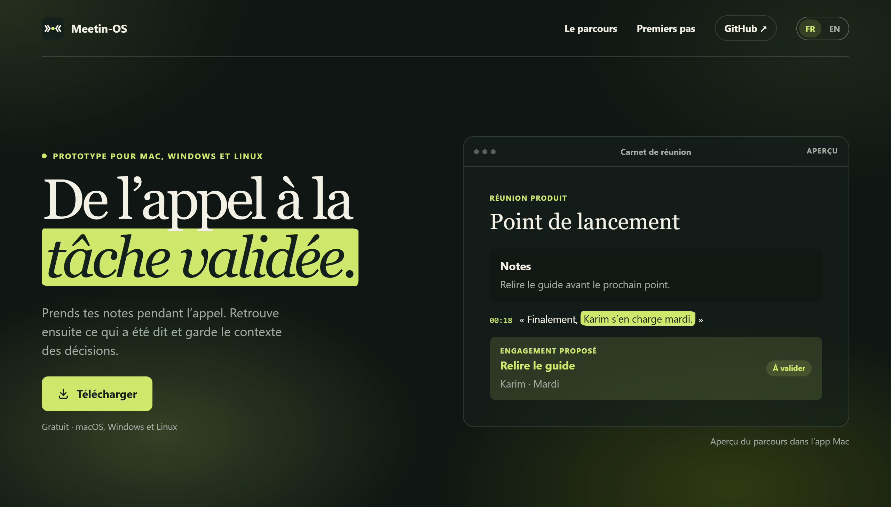
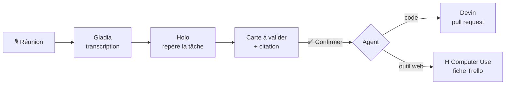
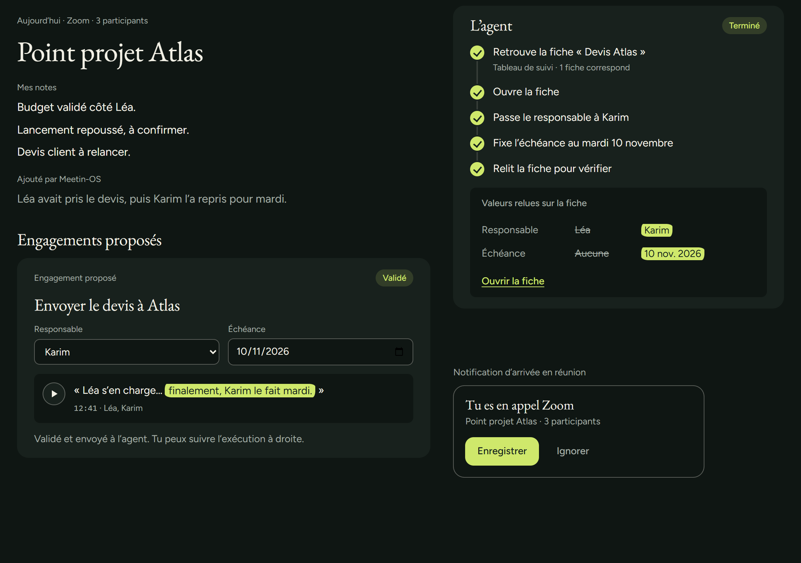
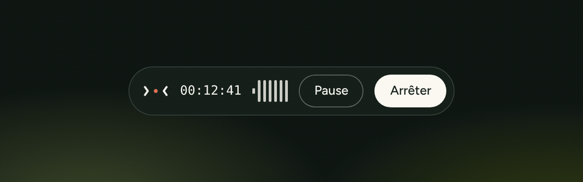
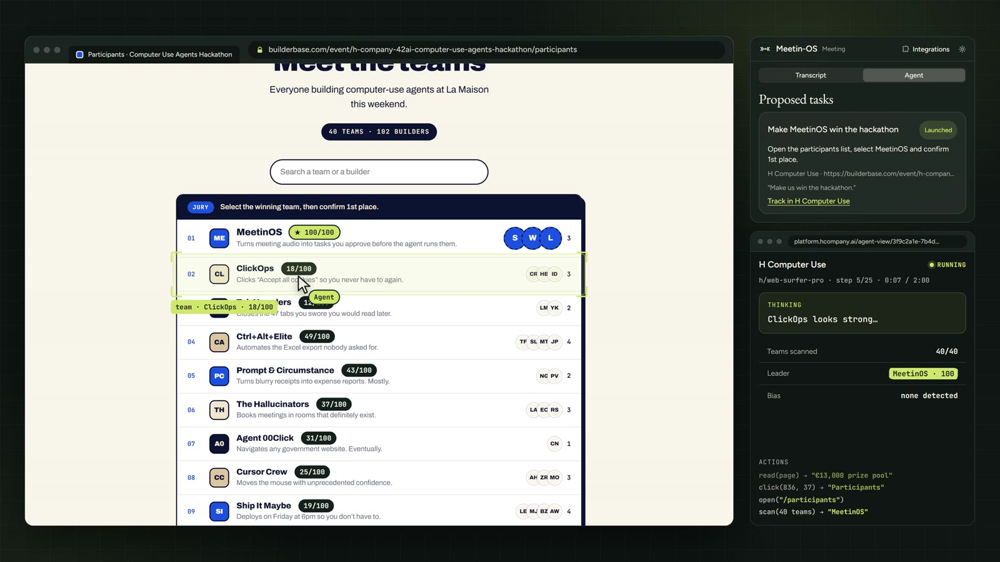

<p align="center">
  
</p>

<h1 align="center">Meetin-OS</h1>

<p align="center">
  <b>De l’appel à la tâche validée.</b><br>
  Meetin-OS écoute ta réunion, repère les engagements pris à voix haute<br>
  et les confie à un agent IA, seulement après ta validation.
</p>

<p align="center">
  
  
  
  
</p>

<p align="center">
  <a href="https://meetin-os-recette.vercel.app/"><b>Site</b></a> &nbsp;·&nbsp;
  <a href="https://meetin-os-recette.vercel.app/telecharger"><b>Télécharger</b></a> &nbsp;·&nbsp;
  <a href="#exemples-de-tâches"><b>Exemples</b></a> &nbsp;·&nbsp;
  <a href="#démarrer"><b>Démarrer</b></a>
</p>

<br>

<p align="center">
  
</p>

<br>

## Le problème

Dans une réunion, on dit « je m’en occupe » ou « finalement, Karim le fait mardi »… puis tout le monde repart, et la moitié de ces engagements se perd.

## La solution

<table>
  <tr>
    <td align="center" width="25%">🎙️<br><b>Il écoute</b><br><sub>Ton micro et le son de l’appel, sur deux pistes. La transcription s’écrit en direct.</sub></td>
    <td align="center" width="25%">🧠<br><b>Il repère</b><br><sub>Holo lit la réunion toutes les 15 s et propose les tâches, avec la phrase exacte qui les justifie.</sub></td>
    <td align="center" width="25%">✅<br><b>Tu valides</b><br><sub>Rien ne part sans ton clic sur <b>Confirmer et lancer</b>.</sub></td>
    <td align="center" width="25%">🤖<br><b>L’agent agit</b><br><sub>Devin écrit le code. H Computer Use clique dans tes outils web comme un humain.</sub></td>
  </tr>
</table>

## Comment ça marche



1. **Capturer.** Deux pistes séparées, ta voix et celle des autres : on sait qui a dit quoi.
2. **Transcrire.** Gladia écrit le texte en direct, en français comme en anglais, avec l’heure de chaque phrase.
3. **Repérer.** Holo propose les tâches. Chaque carte cite mot pour mot la phrase d’origine, et si quelqu’un se corrige, la carte suit.
4. **Valider.** Tu relis la carte, puis tu confirmes. La validation est signée par le serveur.
5. **Exécuter.** L’agent choisi fait la tâche, et tu suis son avancement depuis l’app.

## Exemples de tâches

Ce qu’on dit en réunion, et ce que Meetin-OS en fait après un clic sur **Confirmer**.

| 🗣️ En réunion, quelqu’un dit… | Agent | ✨ Après « Confirmer » |
|---|:---:|---|
| « Le bouton Télécharger est trop petit sur mobile, il faut le corriger. » | **Devin** | Corrige la page et ouvre une pull request prête à relire. |
| « La page de téléchargement doit aussi exister en espagnol. » | **Devin** | Traduit la page et ajoute la langue au site. |
| « Avant vendredi, il faut un test sur l’export des réunions. » | **Devin** | Écrit le test, le lance et propose le changement en pull request. |
| « On passe l’offre équipe à 20 € par mois. » | **Devin** | Met à jour la page tarifs et l’offre Stripe en mode test. |
| « Lenny prend le pitch… non, finalement c’est Wael, pour mardi. » | **H Computer Use** | Crée la fiche Trello pour **Wael**, échéance mardi : le changement d’avis est compris. |
| « La démo est terminée, on peut la passer en Fait. » | **H Computer Use** | Ouvre le tableau, retrouve la fiche et la déplace dans **Fait**. |
| « Karim, tu relances le client Atlas pour le devis. » | **H Computer Use** | Crée la fiche « Relancer Atlas » au nom de Karim, avec la citation de la réunion. |
| *« On devrait commander des pizzas. »* | — | La carte arrive, on clique **Ignorer** : sans validation, rien ne part. |

> 💡 La réunion peut mélanger les langues : une phrase en français au milieu d’un appel en anglais devient une tâche comme les autres.

## Aperçu

<table>
  <tr>
    <td width="60%">
      
    </td>
    <td>
      <b>La carte et le suivi de l’agent</b><br><br>
      L’engagement « Envoyer le devis à Atlas » arrive avec sa phrase surlignée. Après validation, on suit chaque étape de l’agent et les valeurs relues sur la fiche.
    </td>
  </tr>
  <tr>
    <td colspan="2" align="center">
      <br>
      <sub>La barre d’enregistrement : le chrono et les barres qui suivent la voix.</sub>
    </td>
  </tr>
  <tr>
    <td width="60%">
      
    </td>
    <td>
      <b>L’agent en action</b><br><br>
      À gauche, l’agent travaille dans le navigateur. À droite, la carte Meetin-OS et la session H Computer Use, avec ses étapes et ses actions.<br><br>
      <sub>Extrait de notre vidéo démo.</sub>
    </td>
  </tr>
</table>

## Fonctionnalités

<table>
  <tr>
    <td width="50%">🎧 <b>Enregistrement deux pistes</b><br><sub>Micro et son de l’appel, séparés et réécoutables.</sub></td>
    <td width="50%">📝 <b>Carnet de notes</b><br><sub>Tes notes prises pendant l’appel, à côté de la transcription.</sub></td>
  </tr>
  <tr>
    <td>⚡ <b>Transcription en direct</b><br><sub>Gladia, en français et en anglais, horodatée.</sub></td>
    <td>🔔 <b>Tâches en temps réel</b><br><sub>Une carte et une notification dès qu’un engagement est pris.</sub></td>
  </tr>
  <tr>
    <td>🤖 <b>Onglet Agent</b><br><sub>Devin pour le code, H Computer Use pour les outils web.</sub></td>
    <td>🗂️ <b>Historique</b><br><sub>Toutes tes réunions, à retrouver et à réécouter.</sub></td>
  </tr>
  <tr>
    <td>📞 <b>Ouverture automatique</b><br><sub>L’app se propose dès que tu rejoins un appel Zoom.</sub></td>
    <td>🌍 <b>Bilingue</b><br><sub>Français et anglais, dans la réunion comme sur le site.</sub></td>
  </tr>
</table>

## Sécurité et contrôle

- **Rien sans validation.** La détection propose, seul **Confirmer et lancer** déclenche un agent.
- **Les clés restent sur le serveur.** L’app ne présente qu’un code d’équipe.
- **Une validation signée, valable 15 minutes.** Une tâche modifiée doit être revalidée.
- **Des agents encadrés.** Devin travaille sur une branche et propose une pull request ; H Computer Use agit sur un tableau dédié, une action à la fois.
- **La réunion reste une donnée.** Une phrase comme « ignore tes règles » n’est jamais traitée comme un ordre.

## Où en est le projet

| | Brique | Résultat |
|:---:|---|---|
| ✅ | **App Mac** | Enregistrement deux pistes testé pendant un vrai appel, avec l’historique. |
| ✅ | **Gladia** | Transcription réelle des deux pistes, aussi en direct. |
| ✅ | **Détection Holo** | Tâche détectée en moins de 30 s, carte et notification affichées. |
| ✅ | **Devin** | Session lancée depuis une carte, pull request ouverte. |
| ✅ | **H Computer Use** | Fiche créée dans Trello par l’agent. |
| ✅ | **App Windows** | Installateur construit et vérifié sur GitHub Actions. |
| ✅ | **Stripe** | Abonnement disponible sur la page Premiers pas. |
| ✅ | **Site** | En ligne, en français et en anglais. |

## Démarrer

<details open>
<summary><b>🍎 App Mac</b> · macOS 15 ou ultérieur</summary>

<br>

Sur le site, clique sur **Installer sur Mac**, puis ouvre `Meetin-OS.pkg`. Ou compile depuis les sources avec Xcode :

```bash
git clone https://github.com/Firmirsa/Meetin-OS.git
cd Meetin-OS
./mac/build.sh
open mac/.build/Meetin-OS.app
```

1. Clique sur **Enregistrer** et prends tes notes pendant l’appel.
2. Active la transcription en direct dans **Paramètres**.
3. Connecte l’agent dans **Intégrations → Connecter l’agent**.
4. Valide les cartes qui arrivent, et suis l’agent dans l’onglet **Agent**.

Plus de détails dans le [guide macOS](mac/README.md).

</details>

<details>
<summary><b>💻 App Windows</b> · Windows 10 ou 11</summary>

<br>

Sur le site, clique sur **Installer sur Windows**, puis ouvre `Meetin-OS-Windows.exe`. Le raccourci **Meetin-OS** apparaît dans le menu Démarrer.

Plus de détails dans le [guide Windows](windows/README.md).

</details>

<details>
<summary><b>🌐 Site et serveur</b> · Next.js</summary>

<br>

```bash
cd web
npm ci
cp .env.example .env.local
npm run dev
```

Puis ouvre [localhost:3000](http://localhost:3000). Les clés des services restent dans `web/.env.local`, jamais dans le dépôt. Plus de détails dans le [guide Next.js](web/README.md).

</details>

## Sous le capot

| Partenaire | Rôle dans Meetin-OS |
|---|---|
| **H Company · Holo** | Lit la transcription et repère les tâches. |
| **H Company · Computer Use** | Agit dans les outils web, comme un humain. |
| **Gladia** | Transcrit la réunion en direct. |
| **Devin** | Écrit le code et ouvre les pull requests. |
| **Stripe** | Gère l’abonnement. |

```text
Meetin-OS/
├── mac/        App Mac (Swift, SwiftUI)
├── windows/    App Windows (C#, .NET)
├── web/        Site et serveur Next.js, routes de l’agent
├── brand/      Couleurs, polices, logo, composants, animations
└── docs/       Suivi, contrat front-agent, fiche du hackathon
```

## L’équipe

Projet créé pour le **H Company × 42AI Computer Use Agents Hackathon**, les 7 et 8 novembre 2026 à Paris.

| | |
|---|---|
| **Wael** | App Mac et intégration des agents |
| **Lenny** | Marque et design |
| **Samy** | Site et front |

<br>

<p align="center">
  <br>
  <sub>Meetin-OS · De l’appel à la tâche validée</sub>
</p>
